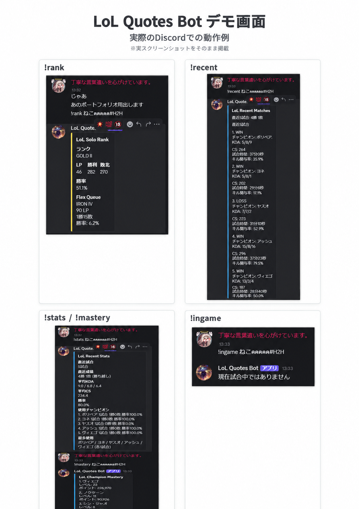

# LoL Quotes Bot

PythonとRiot Games APIを使用して開発した、League of Legends向けDiscord Botです。

Riot IDを入力することで、ランク情報、直近試合、戦績集計、チャンピオンマスタリー、現在の試合情報などをDiscord上から確認できます。

Discord Embedを利用して情報を見やすく表示し、API処理・表示処理・Bot本体をファイルごとに分割することで、保守しやすい構成を意識しています。

現在はOracle Cloud上のOracle Linuxへデプロイし、systemdを利用して常時稼働できる構成にしています。

---

## 主な機能

### ランク情報表示

```text
!rank ゲーム名#タグ
```

Riot Games APIを利用して、指定したプレイヤーのランク情報を取得します。

表示する情報：

- ソロランク
- フレックスランク
- Tier / Division
- LP
- 勝利数
- 敗北数
- 勝率

取得した情報はDiscord Embedで表示します。

---

### 直近試合表示

```text
!recent ゲーム名#タグ
```

指定したプレイヤーの直近5試合を取得します。

表示する情報：

- WIN / LOSS
- 使用チャンピオン
- KDA
- CS
- 試合時間
- キル関与率

Match-V5 APIとTimeline APIを利用しています。

Data Dragonから取得したデータを利用し、チャンピオン名は日本語で表示します。

---

### 戦績集計

```text
!stats ゲーム名#タグ
```

直近試合の情報をPython側で集計して表示します。

表示する情報：

- 直近試合数
- 勝敗数
- 勝率
- 平均KDA
- 平均CS
- 使用チャンピオン
- チャンピオン別勝敗
- チャンピオン別勝率
- 最多使用チャンピオン

複数試合のAPIレスポンスを取得し、必要な情報を集計しています。

---

### チャンピオンマスタリー表示

```text
!mastery ゲーム名#タグ
```

指定したプレイヤーのチャンピオンマスタリー上位3体を表示します。

表示する情報：

- チャンピオン名
- マスタリーレベル
- マスタリーポイント

Champion Mastery-V4 APIを利用しています。

---

### 現在の試合情報

```text
!ingame ゲーム名#タグ
```

指定したプレイヤーが現在試合中の場合、参加しているチャンピオン情報を取得します。

表示する情報：

- 味方チーム
- 敵チーム
- 使用チャンピオン

Spectator-V5 APIを利用しています。

試合中ではない場合は、その旨をDiscord上へ表示します。

---

## LoLセリフ機能

このBotは、もともとPython学習用の「LoLランダムセリフBot」として制作を開始しました。

現在も以下のセリフ機能を使用できます。

### 指定チャンピオンのランダムセリフ

```text
!quote チャンプ名
```

指定したチャンピオンに登録されているセリフから、ランダムで1つ表示します。

---

### 全チャンピオンからランダム表示

```text
!quote random
```

登録されているチャンピオンからランダムで1体を選び、そのチャンピオンのセリフを表示します。

---

### セリフ一覧

```text
!quote list チャンプ名
```

指定したチャンピオンに登録されているセリフを一覧表示します。

---

### 登録チャンピオン一覧

```text
!champions
```

登録されているチャンピオンと、それぞれのセリフ数を表示します。

---

### 登録数表示

```text
!count
```

登録されているチャンピオン数とセリフの合計数を表示します。

セリフデータは `quotes.json` で管理しています。

---

## GitHub API機能

```text
!github ユーザー名
```

GitHub APIを利用して、指定したGitHubユーザーの情報を取得します。

表示する情報：

- ユーザー名
- 名前
- 公開リポジトリ数
- フォロワー数
- フォロー数

存在しないユーザー名が指定された場合は、エラーメッセージを表示します。

---

## ヘルプ

```text
!help
```

使用できるコマンド一覧をDiscord Embedで表示します。

---

## 現在使用できるコマンド

```text
こんにちは

!quote チャンプ名
!quote random
!quote list チャンプ名

!champions
!count
!help

!github ユーザー名

!rank ゲーム名#タグ
!recent ゲーム名#タグ
!stats ゲーム名#タグ
!mastery ゲーム名#タグ
!ingame ゲーム名#タグ
```

---

## Riot APIのエラー処理

Riot Games APIのHTTPステータスコードに応じて、Discord上へ異なるエラーメッセージを表示します。

```text
401 : APIキーが無効、または期限切れ
403 : APIへのアクセスが拒否された
404 : Riot IDが見つからない
429 : APIへのアクセス回数が多すぎる
```

複数のRiot系コマンドで共通して利用するエラー処理は関数化しています。

---

## 使用技術

### 開発

- Python
- discord.py
- requests
- python-dotenv
- JSON
- Git
- GitHub
- GitHub Desktop
- Visual Studio Code
- PowerShell

### API

- Riot Games API
- Account-V1
- League-V4
- Match-V5
- Timeline API
- Champion Mastery-V4
- Spectator-V5
- Data Dragon
- GitHub API

### インフラ・運用

- Oracle Cloud
- Oracle Linux
- SSH
- Python venv
- systemd
- Linux Swap
- SELinux
- GitHub clone / pull

---

## システム構成

```text
Discord
   ↓
LoL Quotes Bot
   ↓
Oracle Cloud VM
   ↓
Python / discord.py
   ↓
┌─────────────────────────────┐
│ Riot Games API              │
│ Data Dragon                 │
│ GitHub API                  │
└─────────────────────────────┘
```

BotはOracle Cloud上のLinux VMで動作しています。

Discordからコマンドを受け取り、必要に応じて各APIへアクセスし、取得したデータを整形してDiscord Embedとして返します。

---

## ファイル構成

```text
lol-quotes-bot
│
├─ champion_discord_bot.py
├─ riot_api.py
├─ embeds.py
├─ champion_bot.py
├─ quotes.json
├─ api_test.py
├─ riot_test.py
├─ requirements.txt
├─ README.md
├─ .gitignore
└─ Practice_old/
```

`.env` は秘密情報を含むためGitHubにはアップロードしていません。

---

## ファイルの役割

### champion_discord_bot.py

Discord Bot本体です。

Discord上のメッセージを受け取り、各コマンドに応じて処理を行います。

主に以下を担当しています。

- Discordイベント処理
- コマンド判定
- Riot IDの分割
- PUUID取得
- APIレスポンス処理
- エラー処理
- 戦績集計
- 各機能の呼び出し

---

### riot_api.py

Riot Games APIとの通信処理をまとめています。

主な処理：

```text
Riot IDからアカウント情報取得
ランク情報取得
直近試合ID取得
試合データ取得
Timeline取得
Champion Mastery取得
Spectator情報取得
Data Dragonからチャンピオン情報取得
```

API通信処理をBot本体から分離することで、役割を明確にしています。

---

### embeds.py

Discord Embedの生成処理をまとめています。

主なEmbed：

```text
ランク
直近試合
マスタリー
戦績
試合中情報
ヘルプ
```

表示処理をBot本体から分離することで、Botの処理とUI生成処理を分けています。

---

### quotes.json

LoLチャンピオンのセリフを保存しているJSONファイルです。

Bot本体とセリフデータを分離することで、Pythonコードを変更せずにチャンピオンやセリフを追加できます。

---

### champion_bot.py

Discord Bot化する前に制作した、ローカル環境用のLoLセリフBotです。

Pythonの基本文法やJSONの扱いを学習するために制作しました。

---

### api_test.py

GitHub APIとの通信処理を学習・確認するために使用したテストファイルです。

主に以下を確認しました。

```text
requests.get()
response.status_code
response.json()
```

---

### riot_test.py

Riot Games APIをDiscord Botへ組み込む前に、API単体で通信確認を行うために使用したテストファイルです。

Riot IDからPUUIDを取得し、そのPUUIDを利用してランク情報を取得する処理などを確認しました。

---

### requirements.txt

Botの動作に必要なPythonライブラリを管理しています。

```text
discord.py
python-dotenv
requests
```

---

## セキュリティ

Discord Bot TokenとRiot API Keyは `.env` で管理しています。

```text
DISCORD_TOKEN=...
RIOT_API_KEY=...
```

`.gitignore` に以下を指定しています。

```text
.env
__pycache__/
*.pyc
```

TokenやAPI Keyをソースコードへ直接記述せず、GitHubにもアップロードしない構成にしています。

Oracle Cloud上でも同様に `.env` を利用しています。

---

## コード整理

機能追加によってBot本体が大きくなったため、処理を役割ごとに分割しました。

```text
champion_discord_bot.py
→ Discord Bot本体・コマンド制御

riot_api.py
→ Riot Games APIとの通信処理

embeds.py
→ Discord Embed生成
```

また、以下のような共通処理を関数化しています。

```text
Riot IDの分割
API Header生成
PUUID取得
APIエラー処理
Solo / Flexランク検索
勝率計算
```

関数には型ヒントを追加し、引数や戻り値が分かりやすくなるようにしています。

---

## Logging

`logging` モジュールを利用し、Botの起動状況やDiscord Gatewayへの接続状況を確認できるようにしています。

開発初期は `print()` を利用していましたが、コード整理の段階でloggingへ移行しました。

---

## クラウドデプロイ

完成したBotをOracle Cloud上のOracle Linuxへデプロイしています。

主な流れ：

```text
GitHub
↓
Oracle Cloud VM
↓
git clone
↓
Python venv
↓
requirements.txt
↓
.env
↓
Bot起動
```

ローカルPCとは別のLinux環境でBotを動かすことで、環境差によるエラーへの対応も経験しました。

---

## 常時稼働

Linuxの `systemd` を利用し、Botをサービスとして起動しています。

これにより、

```text
SSH接続を終了
PCをシャットダウン
```

した状態でもBotが動作します。

また、サービスを有効化しているため、VM再起動後もBotが自動起動する構成にしています。

---

## 開発中に発生した問題と解決

### Pythonのインデント

`if / elif / else / for` が複雑になった際、インデントがずれることで意図しない処理が実行される問題がありました。

エラー箇所だけでなく、処理がどのブロックに所属しているかを確認することの重要性を学びました。

---

### APIのHTTPステータスコード

APIから必ず正常なレスポンスが返るとは限らないため、HTTPステータスコードを確認して処理を分岐するようにしました。

特にRiot Development API Keyの期限切れやRiot IDが存在しない場合などを考慮しています。

---

### Pythonバージョンの違い

ローカル環境ではPython 3.14を使用していましたが、Oracle LinuxではPython 3.9を使用しました。

ローカルでは動作していた以下の型ヒントが、

```python
dict | None
```

Python 3.9では動作しない問題が発生しました。

そこで、

```python
Optional[dict]
```

へ変更し、Python 3.9でも動作できるように修正しました。

---

### Linux VMのメモリ不足

Oracle Cloudの無料VMでGitをインストールする際、メモリ不足によってプロセスが強制終了する問題が発生しました。

Linux Swap領域を追加することで、メモリ不足を回避しました。

---

### SSH秘密鍵の権限

WindowsからOracle LinuxへSSH接続する際、秘密鍵ファイルのアクセス権限が広すぎるためSSHから利用を拒否されました。

Windowsのファイル権限を変更し、自分のユーザーのみが秘密鍵を読み取れる状態へ変更することで解決しました。

---

### Python仮想環境

ローカル環境とOracle Linux上のPython環境を分離するため、`venv` を利用しました。

これによりBotに必要なライブラリをOS全体のPython環境から分離して管理しています。

---

### systemdによるBot起動

Botを手動で起動した場合は正常に動作しましたが、systemd経由では以下の問題が発生しました。

```text
Permission denied
203/EXEC
200/CHDIR
```

`systemctl status`、`journalctl`、`ausearch` などのログを確認しながら原因を切り分けました。

実行パス、仮想環境、作業ディレクトリなどを見直し、最終的にsystemdからBotを正常起動できる構成に修正しました。

---

## セットアップ方法

### 1. リポジトリをclone

```bash
git clone https://github.com/RYOYAMAMOTOpython/lol-quotes-bot.git
```

```bash
cd lol-quotes-bot
```

---

### 2. 仮想環境を作成

Windowsの場合：

```powershell
py -m venv venv
```

Linuxの場合：

```bash
python3 -m venv venv
```

---

### 3. 仮想環境を有効化

Windows：

```powershell
venv\Scripts\activate
```

Linux：

```bash
source venv/bin/activate
```

---

### 4. 必要なライブラリをインストール

```bash
python -m pip install -r requirements.txt
```

---

### 5. `.env` を作成

プロジェクトフォルダ内に `.env` を作成します。

```text
DISCORD_TOKEN=自分のDiscord Bot Token
RIOT_API_KEY=自分のRiot API Key
```

TokenやAPI KeyはREADMEやソースコードへ直接記述しないようにします。

---

### 6. Botを起動

```bash
python champion_discord_bot.py
```

Discord上でBotがオンラインになれば起動成功です。

---

## 学んだこと

このBotの制作を通して、以下を学びました。

```text
Python基礎
if / elif / else
for
list
dict
関数
型ヒント
JSON
async / await
Discord Bot
Discord Embed
requests
REST API
HTTPステータスコード
JSONレスポンス
環境変数
Git / GitHub
コード分割
logging
デバッグ
Linux
SSH
Python venv
Linux Swap
Oracle Cloud
systemd
クラウドデプロイ
常時運用
```

最初はローカル環境で動作する簡単なセリフBotとして制作しました。

そこから、

```text
Python基礎
↓
JSON
↓
Discord Bot
↓
GitHub API
↓
Riot Games API
↓
Match / Timeline API
↓
戦績集計
↓
コード分割
↓
エラー処理
↓
Git / GitHub
↓
Oracle Cloud
↓
Linux / SSH
↓
systemd
↓
常時稼働
```

という形で段階的に機能と技術範囲を広げています。

---

## 今後の改善

今後は以下の改善を検討しています。

- データベースを利用したデータ保存
- Discord Slash Commandへの対応
- APIレスポンスのキャッシュ
- テストコードの追加
- 非同期HTTP通信への移行
- Web画面との連携
- ログ管理の強化
- コマンド処理のさらなる分割

---

## 開発目的

Python・API・Discord Bot開発を学習する目的で制作を開始しました。

現在は単に機能を追加するだけでなく、

```text
コードの保守性
APIエラー処理
秘密情報の管理
GitHubによるバージョン管理
クラウド環境へのデプロイ
Linux環境での運用
常時稼働
```

まで含めた開発を経験することを意識しています。